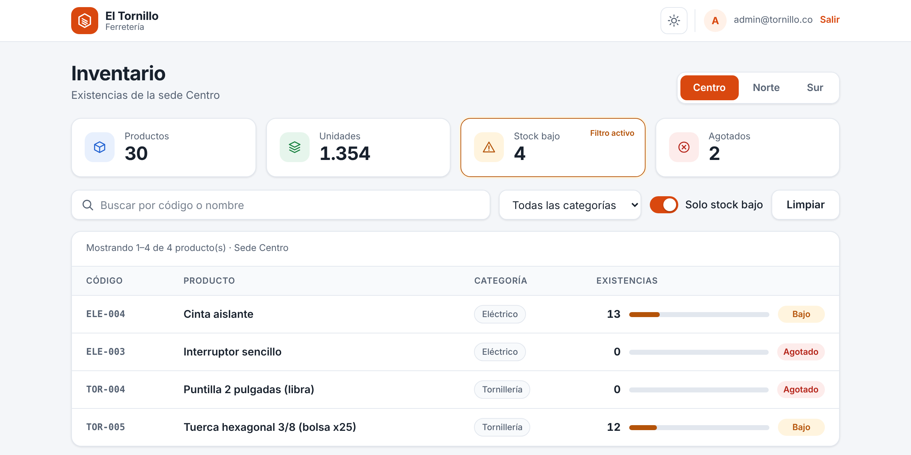
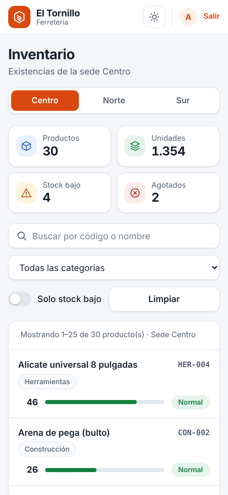

# Ferretería "El Tornillo" — inventario compartido en la nube

Proyecto final de *Paradigmas Emergentes en Computación en la Nube* (Maestría en Ingeniería de Sistemas, Escuela Colombiana de Ingeniería, PENU 2026-2).

Una ferretería con tres sedes necesita saber qué hay en cada bodega sin llamar por teléfono. Esta aplicación permite que cada empleado inicie sesión con su cuenta y consulte el inventario de **su** sede; el rol `admin` ve todas. Corre en Azure, se despliega con Terraform y GitHub Actions, y no guarda ninguna contraseña en el código.





## Qué puede hacer el usuario (MVP)

- Iniciar sesión con su cuenta de Microsoft Entra ID.
- Cambiar entre las sedes que tiene permitidas (Centro, Norte, Sur).
- Ver un resumen de la sede: productos, unidades, productos con stock bajo y agotados.
- Buscar por código o nombre, filtrar por categoría y ver solo el stock bajo (menos de 15 unidades). La tarjeta "Stock bajo" activa ese filtro con un clic.
- Navegar el listado con paginación; cada producto muestra una barra y la etiqueta Normal, Bajo o Agotado.
- Usar la página en el celular y elegir tema claro u oscuro (se recuerda la elección).

Carga de CSV, reporte semanal y movimientos de inventario están diseñados (HLD, diagramas y costos) pero no forman parte del MVP.

## Arquitectura (resumen)

```
Navegador ──HTTPS──> Azure Static Web Apps (Standard) ──> Azure Functions (API Node.js 22)
   (login Entra ID)        frontend + autenticación              │ identidad administrada
                                                                 ├──> Azure SQL Database (serverless, oferta gratuita)
                                                                 ├──> Key Vault (secretos, RBAC)
                                                                 ├──> Blob Storage (CSV, reportes)
                                                                 └──> Application Insights + Log Analytics
```

- **Sin contraseñas ni secretos en el código:** la API usa identidad administrada para la base; GitHub Actions usa OIDC; Azure SQL solo acepta Entra ID.
- **Multi-sede en una sola base (pool):** columna `sede_id` + filtro en la consulta + *Row-Level Security* como defensa adicional.
- **Infraestructura como código:** Terraform (`infra/`). **Pipeline:** GitHub Actions (`.github/workflows/`).
- Dos ambientes idénticos: `dev` y `prod`, ambos con Static Web Apps Standard (único plan que permite enlazar una Function App propia). `prod` exige aprobación manual.
- Regiones: Central US para los datos y East US para la Function App (en Azure for Students solo East US tiene cuota del plan de consumo).

## API

Todas las rutas, salvo `health`, exigen sesión; la API revisa además que el usuario tenga permiso sobre la sede pedida (403 si no).

| Ruta | Parámetros | Respuesta |
|---|---|---|
| `GET /api/health` | — | Estado, conexión a la base y versión desplegada (pública, la usa la prueba de humo) |
| `GET /api/inventario` | `sede` (1–3), `q`, `categoria`, `bajo` (1/0), `pagina`, `limite` (máx. 100) | `total` real, `pagina`, `umbralBajo` e `items` ordenados por nombre |
| `GET /api/categorias` | `sede` | Categorías de la sede |
| `GET /api/resumen` | `sede` | `productos`, `unidades`, `bajo`, `agotados` |

Los parámetros se validan antes de tocar la base y llegan a SQL siempre como parámetros, nunca concatenados.

## Estructura

| Carpeta | Contenido |
|---|---|
| `api/` | API de inventario (Azure Functions, Node.js 22) y pruebas (`npm test`) |
| `web/` | Frontend estático y `staticwebapp.config.json` (rutas protegidas, cabeceras de seguridad) |
| `db/` | Esquema, datos de ejemplo distintos para dev y prod (`02_seed.dev.sql` y `02_seed.prod.sql`), Row-Level Security y usuario de la identidad administrada |
| `scripts/` | `db-init.js` (inicializa la base con token Entra), `smoke-test.sh`, `cost_gate.py` (control de costos) y `verificar_precios.sh` |
| `infra/bootstrap` | Se ejecuta una vez a mano: estado remoto de Terraform + identidad OIDC de GitHub |
| `infra/modules/app` | Todos los recursos de un ambiente |
| `infra/environments/{dev,prod}` | Ambientes que usan el módulo |
| `.github/workflows/` | `ci.yml`, `deploy.yml` (dev → prueba de humo → prod con aprobación), `destroy.yml` |
| `docs/capturas/` | Imágenes de este README |

## Pruebas locales

```bash
cd api
npm ci
npm test        # 75 pruebas (validación, autorización, consulta, resumen, funciones HTTP)
npm run lint
```

## Pipeline

1. **CI** (`ci.yml`): lint y pruebas de la API, pruebas del control de costos, `terraform fmt`/`validate` y Checkov.
2. **Deploy** (`deploy.yml`): CI → dev → prueba de humo → aprobación manual → prod. Cada ambiente ejecuta el mismo flujo reutilizable (`_deploy.yml`): login OIDC, `plan`, *cost gate*, `apply`, despliegue de la API, inicialización de la base, despliegue de la web y prueba de humo.
3. **Verificación del proveedor de identidad:** Static Web Apps entrega la identidad del usuario a la Function App mediante un proveedor de autenticación que se registra al enlazarlas. Si un `apply` lo borra, la API respondería 401 aunque la sesión sea válida. Un paso del pipeline lo comprueba antes de la prueba de humo; si falta, vuelve a enlazar la API y, si no lo logra, el despliegue falla.
4. El resumen de cada ejecución muestra la URL del sitio, la versión y el grupo de recursos.

Tiempos medidos: CI 41 s, dev 5 min 18 s y prod 4 min 28 s, unos 10 minutos de punta a punta sin contar la espera de la aprobación.

## Control de costos en el pipeline

Antes de cada `apply`, el paso **Cost gate** (`scripts/cost_gate.py`) lee el plan de Terraform, estima el costo mensual con los precios de `scripts/cost_prices.json` y **falla si supera el presupuesto** (dev 10 USD, prod 30 USD; se cambia con la variable `COST_BUDGET_USD` del ambiente). Un recurso sin regla de precio también hace fallar el paso. El resultado aparece en el resumen de la ejecución. Para probarlo: `COST_BUDGET_USD=0` hace que el despliegue se detenga antes de crear nada.

```bash
python3 -m unittest discover -s scripts/tests -v
```

## Datos de ejemplo y roles

Cada entorno carga sus propios datos de ejemplo en cada despliegue. Los archivos `db/NN_nombre.dev.sql` y `db/NN_nombre.prod.sql` solo corren en su entorno; los demás corren en los dos. En prod, `02_seed.prod.sql` carga 30 productos en las 3 sedes con algunos en cero para ver el estado Agotado y es idempotente. En dev, `02_seed.dev.sql` reemplaza el catálogo por 41 productos pensados para probar: existencias en 0, 1, 14, 15 y 16 (el umbral de stock bajo es 15), cantidades grandes, un nombre largo, un producto que solo existe en la sede Centro y más de 25 productos por sede para la paginación. Por eso dev se reinicia a ese estado en cada despliegue, y nunca debe tener datos que importen. Para dar acceso a un usuario: en el portal de Azure, *Static Web App → Role management → Invite*, con los roles `sede_1`, `sede_2`, `sede_3` o `admin`.

## Solución de problemas

- **La primera consulta tarda hasta un minuto:** la base gratuita se pausa sola cuando no se usa y se reanuda con la primera consulta. La página lo avisa. Conviene "despertarla" antes de una demostración.
- **La API responde 401 con la sesión iniciada (prod):** cierra sesión y entra de nuevo. Si sigue, revisa que la autenticación de la Function App tenga activo el proveedor `azureStaticWebApps` (`az rest --method get --url ".../sites/<function>/config/authsettingsV2?api-version=2022-03-01"`) y, si falta, desenlaza y vuelve a enlazar el backend con `az staticwebapp backends unlink` y `link`. El pipeline hace esto solo.

## Puesta en marcha (una sola vez)

Requisitos: Azure CLI, Terraform >= 1.11, suscripción Azure for Students, repo en GitHub.

1. `az login` con la cuenta de la universidad.
2. Bootstrap:
   ```bash
   cd infra/bootstrap
   cp terraform.tfvars.example terraform.tfvars   # editar subscription_id y github_repo
   terraform init && terraform apply
   terraform output
   ```
   Si el login OIDC falla con `AADSTS700213`, rellena `github_subject_repo` con el subject que muestra GitHub (`OWNER@ID/REPO@ID`).
3. En GitHub, *Settings → Secrets and variables → Actions → Variables*, crea (son identificadores, no secretos): `AZURE_CLIENT_ID`, `AZURE_TENANT_ID`, `AZURE_SUBSCRIPTION_ID`, `SQL_ADMIN_OBJECT_ID`, `SQL_ADMIN_LOGIN`, `TFSTATE_RESOURCE_GROUP`, `TFSTATE_STORAGE_ACCOUNT`, `TFSTATE_CONTAINER` (los entrega `terraform output`) y `BUDGET_EMAIL` (obligatoria: correo de las alertas de presupuesto y de errores; sin ella el plan falla).
4. *Settings → Environments*: crea `dev` y `prod`; en `prod` agrega **Required reviewers**.
5. `git push` a `main`: se ejecuta CI → deploy dev → prueba de humo → (aprobación) → deploy prod.
6. Dar acceso a usuarios: en el portal de Azure, *Static Web App → Role management → Invite*, con los roles `sede_1`, `sede_2`, `sede_3` o `admin` (el portal solo acepta letras, números y guion bajo en los roles; la API reconoce también `sede-1`).

## Limpieza (importante: cada ambiente con Static Web Apps Standard cuesta USD 9/mes)

Ejecutar el workflow **Destroy** para `prod` y `dev`, y después `terraform destroy` en `infra/bootstrap`.

## Decisiones y riesgos conocidos

- **Identidad de GitHub Actions:** es una identidad administrada con credenciales federadas, porque el tenant de la universidad no permite crear aplicaciones de Entra.
- **Static Web Apps Standard** en dev y prod: el plan Free no tiene SLA ni permite enlazar una Function App propia, y con él dev no podía consultar el inventario. Cuesta USD 9 más al mes por ambiente.
- **Oferta gratuita de Azure SQL:** al agotar 100.000 vCore-s/mes la base se pausa hasta el mes siguiente (riesgo para la disponibilidad); hay alerta de presupuesto y el consumo se revisa antes de la demo.
- **Sin private endpoints** para mantener el costo bajo (`.checkov.yml` documenta cada excepción de seguridad).
- **R11:** la Function App podría aceptar llamadas directas con una cabecera `x-ms-client-principal` falsificada. La prueba de humo lo verifica en prod y emite una advertencia si ocurre.
- **Estado de verificación:** CI pasa (75 pruebas de la API, pruebas del control de costos, fmt, validate y Checkov) y el pipeline completo dev → prod se ejecutó con éxito contra Azure.
